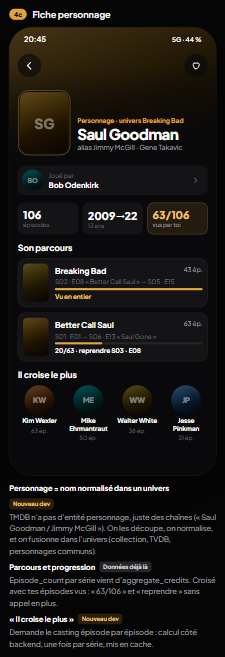

# Complément Explorer — fiche personnage 4c

Référence reçue le29octobre2026, en complément du handoff28octobre (#787, issue personnage existante [#398](https://github.com/julfou7/seenit-app/issues/398)).
Le propriétaire précise : personnage de fiction, par exemple **Saul Goodman**, et non fiche acteur.

## Cible produit

- Identité propre au personnage dans un univers : nom canonique, aliases, avatar ou initiales.
- Bandeau « Joué par » ouvrant la fiche de l’interprète.
- Statistiques : apparitions, période, progression réellement démontrée.
- Parcours par titre : affiche, épisodes/films crédités, état vu/reprise ; accès au titre.
- Trois ou quatre personnages les plus croisés, avec données de co-crédit par épisode.
- Favori personnage distinct du favori acteur, isolé par UID.

## Données et limites à ne pas masquer

TMDB ne fournit pas d’entité personnage globale. `aggregate_credits` fournit des rôles et des nombres d’épisodes, mais pas la liste exacte des épisodes de chaque rôle. Il ne permet donc pas, seul, de calculer un ratio vu/apparitions ni les co-crédits. La maquette sert de référence visuelle, ses chiffres ne sont jamais des fixtures produit.

Les chaînes de rôle doivent être normalisées sans fusionner des homonymes de plusieurs univers ni supposer que chaque rôle d’un acteur représente un même personnage. Les univers doivent venir du catalogue SeenIt validé, d’une collection TMDB ou d’une relation TVDB officielle déjà résolue. La bibliothèque Breaking Bad / Better Call Saul possède déjà une relation validée dans le catalogue SeenIt.

**Décision validée par le propriétaire** : index public en cache côté backend sur les personnages des titres suivis et des univers reliés. Les vus et favoris restent privés, dérivés côté compte. Les co-crédits nécessitent un calcul par épisode en cache, borné et différé. Aucun scan intégral du catalogue ni fan-out réseau au lancement d’Explorer.

Ce complément E-40..49 active une section Personnages propre entre bibliothèque et TMDB. Elle ouvre sa fiche dédiée ; le bandeau interprète seul ouvre la fiche acteur. Le résultat reste masqué si la source est absente, sans bloquer TMDB.

## Audit du point d’entrée existant

Sur `main` bc571c2, aucune vue `CharacterDetail`/fiche personnage dédiée n’est présente dans `src`. `tmdbClient.getCharacterSearchExpansions` peut enrichir des personnes à partir de chaînes de rôles de crédits, mais le `smartSearchMulti` utilisé en production renvoie la recherche multi TMDB sans appeler cette expansion. Il ne faut pas présenter cette ancienne expansion acteur comme une fiche personnage fonctionnelle.

## Contrat E-40..49 validé

- **E-40** — Index de crédits backend à partir des identités typées de la bibliothèque ; extension aux groupes du manifeste validé et aux collections TMDB exactes. Une série sans relation prouvée conserve son propre univers. Pas de recherche globale approximative.
- **E-41** — Nom normalisé dans un univers, alias crédités ; alias éditoriaux explicites autorisés (Saul Goodman / Jimmy McGill / Gene Takavic, donnés par la maquette). Les homonymes de deux univers restent distincts.
- **E-42** — Métadonnées publiques en cache borné et concurrence fournisseur limitée. Authentification et quotas requis ; aucun historique privé envoyé au fournisseur.
- **E-43** — Fiche conforme4c : identité/initiales, interprète(s) avec photo, trois statistiques, parcours et liens. Une image d’acteur n’est pas présentée comme une image du personnage.
- **E-44** — Progression exacte calculée depuis les identifiants d’épisodes crédités croisés avec les vus locaux. Les compteurs issus du seul aggregate_credits sont libellés « crédités », jamais utilisés pour inventer un ratio vu/apparitions.
- **E-45** — Co-crédits calculés côté serveur depuis les crédits par épisode, au plus quatre liens. Pas de classement fondé sur la simple présence dans un casting de série.
- **E-46** — Calcul détaillé différé à l’ouverture, cache réutilisé, borne d’épisodes et budget réseau. Une couverture partielle est indiquée ; aucune donnée manquante n’est remplacée par les valeurs de la maquette.
- **E-47** — Bouton parcours ouvre la fiche avec le prochain épisode non vu réellement crédité si disponible ; les titres non suivis restent consultables.
- **E-48** — Favoris personnage locaux distincts des acteurs, isolés par UID et conservés sur cet appareil. Synchronisation cloud éventuelle hors de ce premier lot.
- **E-49** — Retour ferme un niveau de dialogue ; acteur et média restent accessibles, clavier/nav et aperçu conservent E-01..33.

## Delta détaillé reçu ensuite le29octobre

Le [delta P-01..12 et E-18/E-19](explorer-delta-personnage-2026-10-29.md) complète les dimensions et les parcours. Décision déléguée par le propriétaire (« meilleur rapport perf / valeur ajoutée / coût ») : crédits exacts différés à la première ouverture, concurrence4, maximum240 épisodes par calcul, cache public24h borné ; aucun fournisseur payant supplémentaire. Les calculs partiels restent indiqués et ne produisent pas de ratio ni de reprise approximatifs. Ce choix remplace le repli proportionnel par saison proposé dans le delta.

Autres replis conservés : initiales du personnage, favori local par UID sans notification, interprète principal dans le bandeau (le modèle conserve les autres interprètes prouvés), liens entre personnages seulement si leur fiche existe. La source bibliothèque/univers a déjà été validée dans le chat.

Le cache public est en mémoire par instance backend, borné à 16 Mio / 256 réponses et 64 fiches détaillées. Les crédits d’un épisode sont réutilisés pour les autres personnages du même univers. Une instance froide recharge progressivement ses preuves ; aucune persistance Firestore ni écriture facturable supplémentaire. Les plafonds de casting/saisons et les erreurs fournisseur rendent la couverture partielle.
